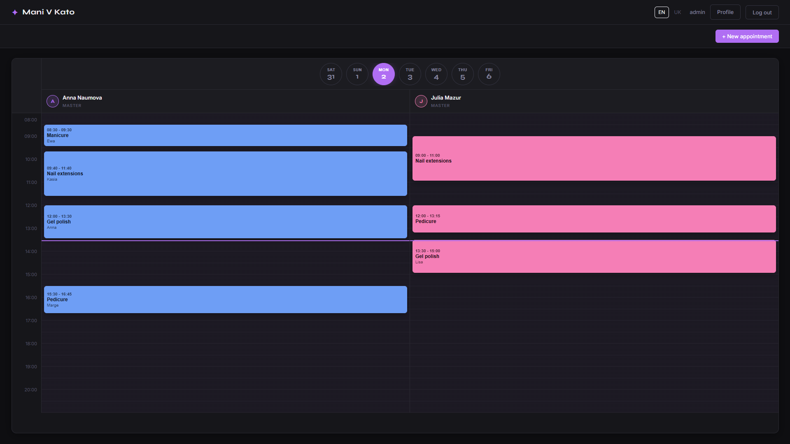
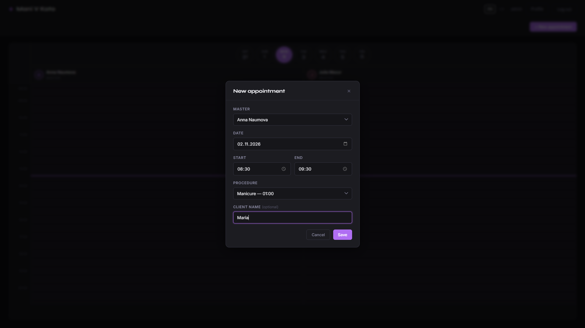
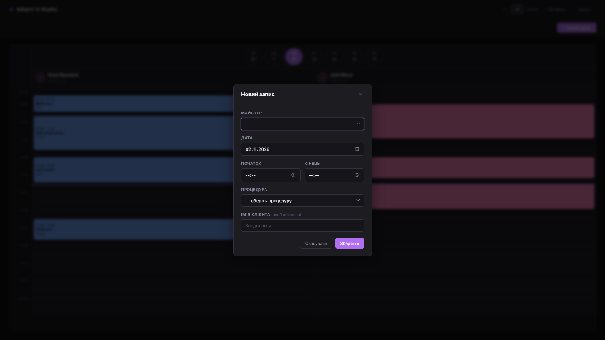
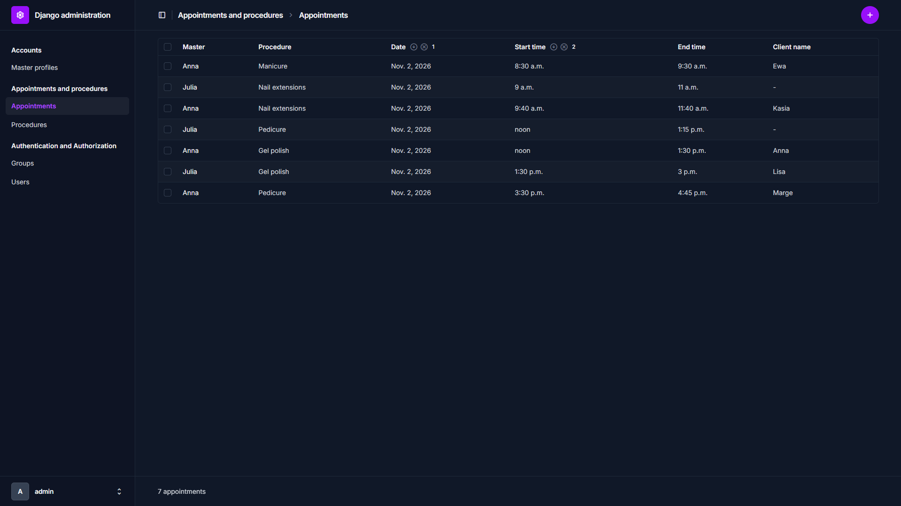

# Mani V Kato — Booking Calendar

Appointment scheduling for a nail salon in Katowice. It was built as an in-house replacement for
Booksy, and the salon has since switched over completely and runs its real bookings on it.

**Live:** https://mani-v-kato-booking.onrender.com (access is limited to salon staff)



## Features

- **Week calendar** with a column per master. The calendar is rendered in vanilla JavaScript from a JSON API.
- **Role-based access.** Masters work only with their own schedule, and administrators manage all masters. Access is enforced server-side.
- **Booking validation.** It prevents overlapping appointments and invalid time ranges.
- **Staff onboarding.** New accounts stay inactive until an administrator approves them.
- **Internationalization.** The interface is in English and Ukrainian (Django i18n for templates, Python and JS).
- **Admin panel** built on django-unfold for procedures, staff and appointments.
- **Dockerized development** with a local PostgreSQL, isolated from production.
- **31 automated tests** covering validation, access control, the API and authentication.

| Appointment form | Ukrainian interface | Admin panel |
|---|---|---|
|  |  |  |

## Tech stack

| Layer | Technology |
|---|---|
| Backend | Python 3.14, Django 6.0 |
| Database | PostgreSQL 17 (Supabase in production) |
| Frontend | Django templates, vanilla JavaScript, CSS |
| Admin | django-unfold |
| Static files | WhiteNoise |
| Config | python-decouple (12-factor, settings from environment) |
| Dev environment | Docker, Docker Compose |
| Hosting | Render (app) + Supabase (PostgreSQL) |

## Getting started

The only requirement is [Docker Desktop](https://www.docker.com/products/docker-desktop/).

```bash
git clone https://github.com/MaksRuzhyk/salon-booking-system.git
cd salon-booking-system

cp .env.docker.example .env.docker
docker compose up --build
```

The app runs at http://127.0.0.1:8000. Migrations are applied automatically on start.

In a second terminal, create an administrator:

```bash
docker compose exec web python manage.py createsuperuser
```

Then open `/admin/`, add a few procedures, and register a master at `/accounts/register/`.
Activate the master in the admin panel, and they can log in and use the calendar.

## Running tests

```bash
docker compose exec web python manage.py test
```

## Updating translations

You don't need this to run the project, because compiled translations are included. The source
strings are in English, and the Ukrainian translations live in `locale/uk/LC_MESSAGES/`.
If you change translatable strings:

```bash
docker compose exec web python manage.py makemessages -l uk --ignore=.venv
docker compose exec web python manage.py makemessages -d djangojs -l uk --ignore=.venv --ignore=staticfiles
# edit the .po files, then:
docker compose exec web python manage.py compilemessages --ignore=.venv
```

The compiled `.mo` files are committed because the production build has no gettext.

## Project structure

```
accounts/        registration, login, profile, master profile model
appointments/    calendar page, appointment and procedure models, JSON API
conf/            settings, URLs, WSGI
locale/          translations (uk)
static/          CSS and JavaScript (calendar.js renders the calendar)
Dockerfile       app image for local development
compose.yaml     app + PostgreSQL
build.sh         Render build: install, collectstatic, migrate
```

## API

`GET /appointments/api/?start=<ISO datetime>&end=<ISO datetime>[&master_id=<id>]`

This returns appointments in the date range as JSON events. It requires authentication. A master
receives only their own appointments, and administrators receive everyone's. It returns `400 Bad Request`
with an error message when `start`/`end` are missing or invalid, or when `master_id` is not an
integer. Edit and delete requests for someone else's appointment return `403 Forbidden`.

## Deployment

Production runs on **Render** (free web service) with **Supabase** PostgreSQL through the Session pooler.

- Build command: `bash build.sh`
- Start command: `gunicorn conf.wsgi:application`

Environment variables (see `.env.example`):

| Variable | Description |
|---|---|
| `SECRET_KEY` | Django secret key |
| `DEBUG` | `False` in production |
| `ALLOWED_HOSTS` | Comma-separated hosts (the Render hostname is added automatically) |
| `DB_NAME`, `DB_USER`, `DB_PASSWORD`, `DB_HOST`, `DB_PORT` | PostgreSQL connection |
| `DB_SSLMODE` | `require` for Supabase, `disable` for local Docker |
| `SECURE_SSL_REDIRECT`, `SECURE_HSTS_*` | HTTPS and security headers |

## Roadmap

- Store profile photos in Supabase Storage (the Render free tier has an ephemeral disk)
- Sign in with Google and two-factor authentication for administrators (django-allauth)
- Translatable procedure names (django-modeltranslation)
- Polish translation
- Move the JSON endpoints to Django REST Framework

## Author

Maksym Ruzhylenko · [GitHub](https://github.com/MaksRuzhyk)
